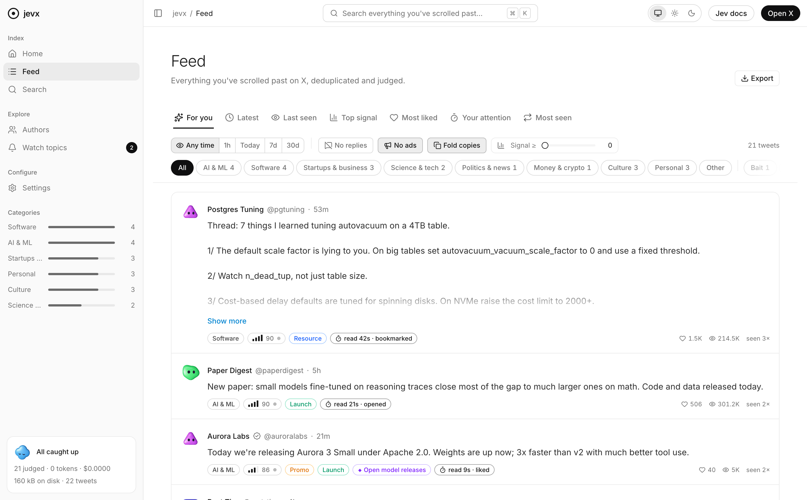
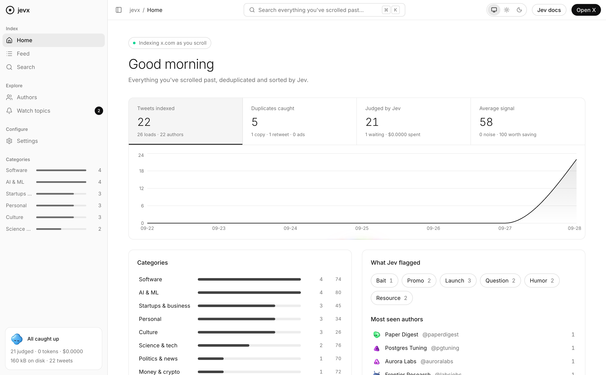
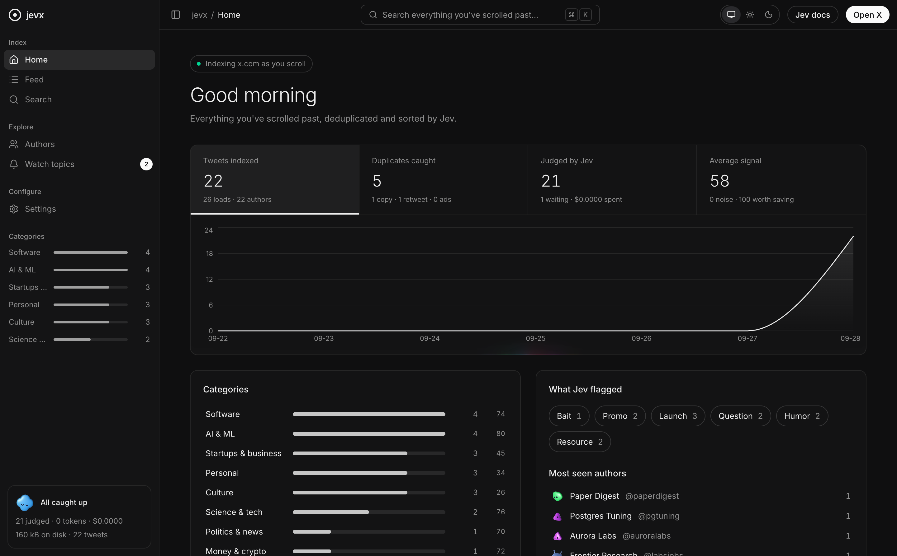
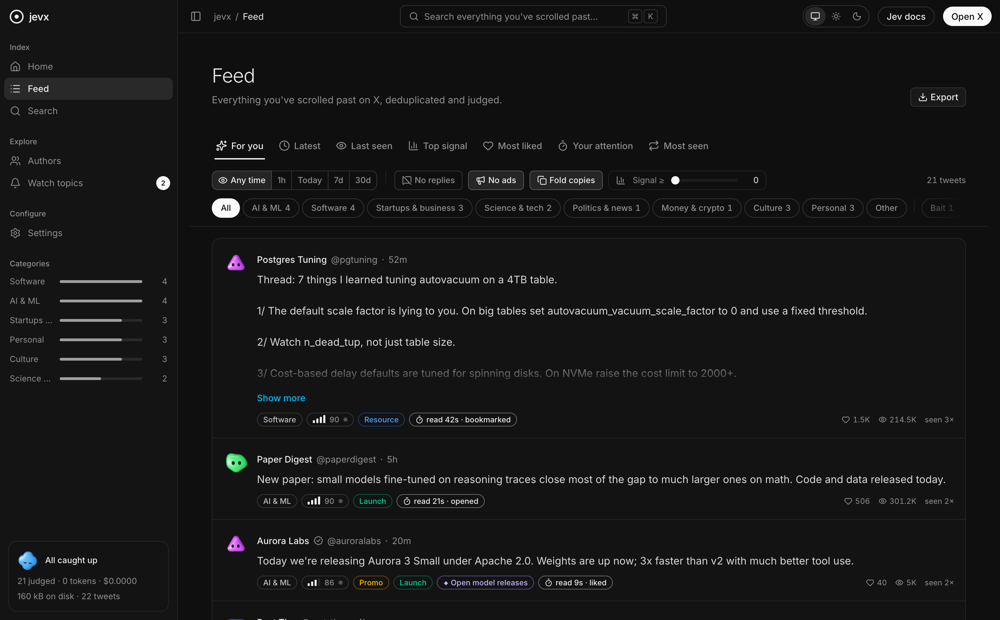
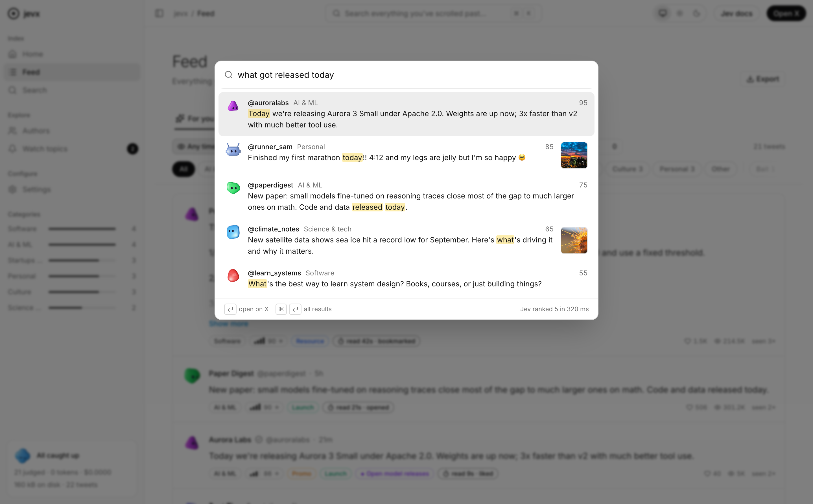
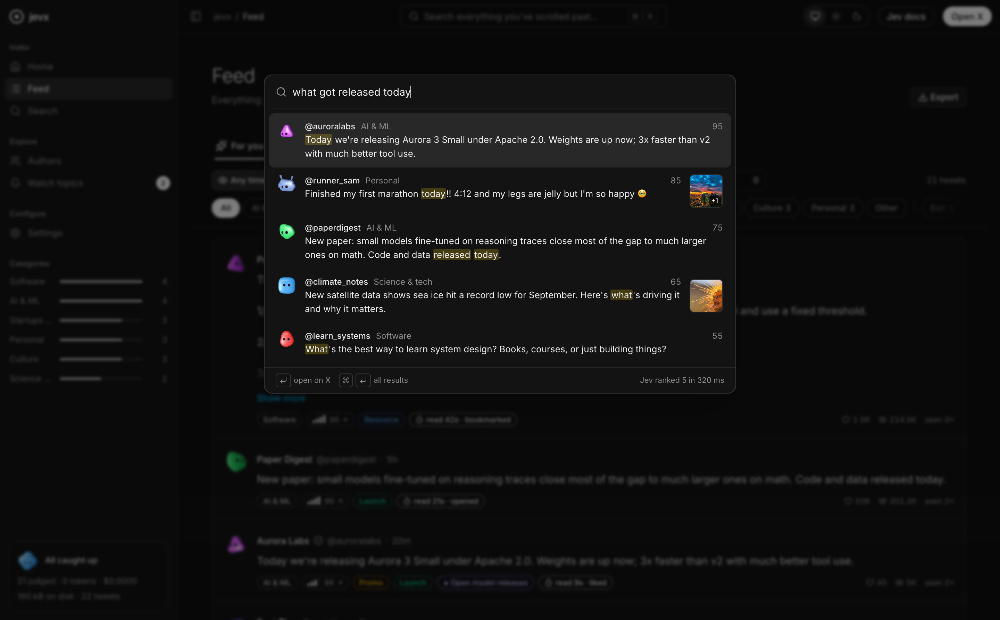

# jevx

A Chrome extension that remembers every tweet you actually read on X. It keeps them in a local SQLite database, folds away duplicates, and uses [TypeSafe](https://typesafe.ai)'s Jev model to sort, score and search them.

<picture>
  <source media="(prefers-color-scheme: dark)" srcset="docs/screenshots/feed-dark.png">
  
</picture>

## What it does

- **Indexes what you've seen.** A tweet is stored once it has been on your screen for a moment, not because X loaded it ahead of your scroll. Tweets it quotes come with it.
- **Deduplicates.** The same tweet across refreshes is one row with a "seen N×" count. A retweet stores the original and remembers who shared it. The same text posted by several accounts folds into the earliest post.
- **Judges with Jev.** Every new tweet gets a category, a signal score (noise → worth saving), a tone, six flags (bait, promo, launch, question, humor, resource) and your own watch topics, at roughly $0.05 per thousand tweets.
- **Searches by meaning.** Keyword hits from SQLite FTS5 arrive in milliseconds, then Jev reranks them by what you meant, as in [jevsearch](https://github.com/kylemclaren/jevsearch). When the words don't match, Jev routes the query to the right categories, so "that chart about GPU prices" still finds an image-only tweet.
- **Reads images.** With **Sign in with ChatGPT**, tweet images are described and their text transcribed using your ChatGPT subscription. The descriptions become searchable and go to Jev, so image tweets are judged on what the picture says.
- **Learns what you care about.** Reading time and clicks become a personal interest score. **For you** blends Jev's signal with your attention and your affinity for each author and category.
- **Shows its work on X.** Small chips under each tweet show its category, signal, flags and copies. Low-signal tweets or bait can fade out.

| | Light | Dark |
|---|---|---|
| **Home** |  |  |
| **Feed** |  |  |
| **⌘K search** |  |  |

<sub>Screenshots use the fictional demo timeline in <code>scripts/demo</code>. Every account and tweet in it is made up.</sub>

## Install

Requires [Bun](https://bun.sh) and Chrome 120 or later.

```bash
git clone https://github.com/kylemclaren/jevx && cd jevx
bun install
bun run build        # typecheck + dashboard + extension scripts → dist/
```

1. Open `chrome://extensions`, turn on **Developer mode**, click **Load unpacked** and choose `dist/`.
2. The dashboard opens on Settings. Paste a [TypeSafe](https://typesafe.ai) API key and click **Test & save**.
3. Optional: under **ChatGPT**, click **Sign in with ChatGPT** to have images described.
4. Browse x.com. Click the toolbar icon to open the dashboard.

After a rebuild, reload the extension on `chrome://extensions` and refresh open x.com tabs.

## How it works

```
x.com page
  inject.js    MAIN world: reads X's Relay store (and taps fetch/XHR as a backup)
      │ postMessage
  content.js   holds tweets until they've been on screen, draws chips, measures attention
      │ chrome.runtime
background.js  service worker: Jev queue, ChatGPT image queue, search, OAuth
      │
offscreen.html → worker: SQLite WASM on OPFS (opfs-sahpool), FTS5 search index
      ▲
dashboard.html React + shadcn/ui (Base UI), Tailwind v4
```

- **Capture.** X's web app (2026) is TanStack Router with Relay, and the first screen of tweets is preloaded server-side with no API call. jevx reads the page's Relay store directly, so it sees every tweet the page holds. It still parses GraphQL responses from older builds, and has a fallback if the page markup changes.
- **Storage.** `@sqlite.org/sqlite-wasm` runs with the `opfs-sahpool` VFS in a dedicated worker inside an offscreen document, the one MV3 context that can hold OPFS sync handles. Settings → Storage shows its size by table, growth per week, the browser quota, and tools to prune and compact.
- **Keys and privacy.** Everything is stored in your browser profile. Only tweet text (and, if you enable it, tweet images) is sent, to TypeSafe and ChatGPT respectively, to be judged. The TypeSafe key and ChatGPT tokens live in `chrome.storage.local`, and only the service worker uses them.
- **ChatGPT sign-in** uses the Codex OAuth flow that OpenAI allows third-party tools to use with ChatGPT plans. Image descriptions count against your plan's Codex usage; Settings has an hourly cap.

## Develop

```bash
bun test                  # extractor, Relay reader, SQLite store, Jev/ChatGPT request mapping
bun run build && bun run demo   # dashboard on fictional data at http://localhost:4789, no extension needed
TYPESAFE_API_KEY=… bun run scripts/smoke.ts   # live check against Jev
```

## Credits

Search ranking follows [jevsearch](https://github.com/kylemclaren/jevsearch). UI built on [shadcn/ui](https://ui.shadcn.com) with [Base UI](https://base-ui.com), plus [liquid-gooey](https://www.npmjs.com/package/liquid-gooey), [border-beam](https://www.npmjs.com/package/border-beam), [thinking-orbs](https://www.npmjs.com/package/thinking-orbs), [bot-avatars](https://www.npmjs.com/package/bot-avatars), [voice-glow](https://www.npmjs.com/package/voice-glow), [metal-fx](https://www.npmjs.com/package/metal-fx), [loading.dev](https://loading.dev), [@web-kits/audio](https://github.com/raphaelsalaja/audio) and [React Bits](https://reactbits.dev).

## License

[MIT](LICENSE)
